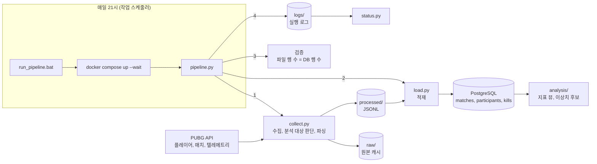
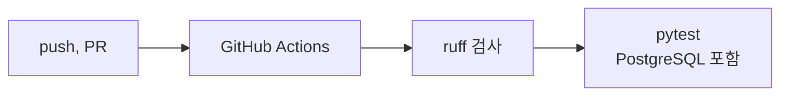

# pubg-data-study

데이터 엔지니어링 학습 저장소입니다. PUBG 공개 API로 매치 데이터를 수집하고 검증한 뒤 분석용 파일로 저장하는 파이프라인을 Python으로 구현합니다.

## 구조





## 폴더 구조

- `collect.py`: PUBG 매치 수집: API → raw 캐시 → 파싱 → processed 저장
- `utils.py`: 데이터 검증 함수 모음 (헤드샷 비율 계산, 참가자와 매치 구조 검증, 손상된 JSON 파일 안전 로드)
- `day09.py` ~ `day14.py`: Python 학습을 위한 코드 연습 파일
- `make_*.py`: day09.py ~ day14.py까지 학습을 위한 가상의 데이터 생성용 파일

## 실행 방법

1. 필요 패키지 설치

```
pip install -r requirements.txt
```

2. PUBG API 키를 환경변수로 설정 (키는 https://developer.pubg.com 에서 발급)

```
# Windows PowerShell (현재 터미널에서만 유지)
$env:PUBG_API_KEY="<your_api_key>"
```

3. 실행

```
python collect.py <player_name>
```
플레이어의 최근 매치 3개를 수집합니다. 플레이어 조회는 PUBG API 제한으로 분당 10회까지 가능합니다.

4. DB 테이블 생성 (처음 한 번)

```
docker compose exec -T db psql -U pubg -d pubg < schema.sql
< 는 명령프롬프트(CMD)에서만 동작 가능
```

5. 적재

```
python load.py
```

여러 번 실행해도 같은 데이터가 중복으로 들어가지 않습니다.

6. 데이터 검증 (선택)

```
python checks/check_keys.py
```

### 테스트

```
pytest
```

GitHub에 push하거나 PR을 만들면 GitHub Actions에서 같은 테스트가 자동으로 실행됩니다. 테스트에는 API 키와 DB가 필요 없습니다.

## 데이터

- `raw/`, `processed/`: 실제 플레이어 정보가 포함되어 있고 코드로 다시 만들 수 있으므로 저장소에 포함하지 않습니다.
- 연습용 데이터(`*.json`, `*.jsonl`, `*.csv`): `make_*.py`로 다시 생성할 수 있으므로 포함하지 않습니다.
- 분석 대상은 배틀로얄 모드(solo, duo, squad와 각 fpp)입니다. 그 외 모드는 수집 단계에서 건너뛰고 실행 로그에 기록합니다.
  - tdm: 부활이 있는 팀 데스매치로, 매치 응답의 참가자 목록이 실제 참가자를 모두 담지 않음
  - zulu-fpp: 좀비를 상대하는 이벤트 모드
  - normal-squad, normal-duo: 커스텀 매치

### 개발 DB 실행 (Docker 필요)

1. `.env.example`을 복사해 `.env`를 만들고 비밀번호를 채웁니다.
2. PostgreSQL 16 컨테이너를 실행합니다.

```
docker compose up -d
docker compose exec db psql -U pubg -d pubg
```

DB는 `localhost:5433`으로 접속합니다. 데이터는 Docker 볼륨에 저장되어 컨테이너를 내려도 유지됩니다.

schtasks /Create /TN "PUBG Pipeline" /TR "cmd.exe /c <프로젝트 경로>\run_pipeline.bat" /SC DAILY /ST 21:00
bat 파일을 직접 지정하면 "액세스가 거부되었습니다"(0x80070005)로 시작되지 않을 수 있어 `cmd.exe /c`로 실행합니다.

### 개발 환경

```
pip install -r requirements-dev.txt
ruff check .
ruff format --check .
pytest
```

GitHub에 push하거나 PR을 만들면 GitHub Actions에서 코드 검사와 테스트가 자동으로 실행됩니다.