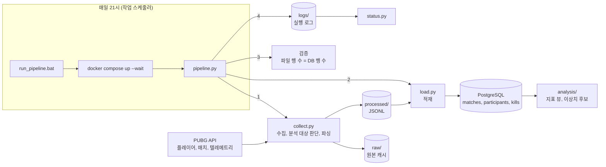
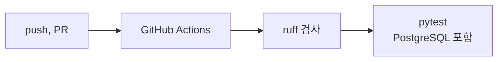

# pubg-data-pipeline

PUBG 공개 API에서 매치와 텔레메트리를 수집해 PostgreSQL에 적재하고, 파일과 DB의 행 수를 검증한 뒤 이상 플레이 후보를 분석하는 파이프라인입니다. 매일 자동으로 실행되며 테스트와 코드 검사는 GitHub Actions에서 돌아갑니다.

| 항목 | 값 (2026-11-06 기준) |
|---|---|
| 수집한 매치 | 136 |
| 사람 플레이어 | 11,709명 |
| 킬 기록 | 12,808건 |
| 원본 데이터 | 약 5.2 GB |
| 전체 재처리 시간 | 41.4초 |
| 테스트 | 55개 (DB 테스트 7개 포함) |

- 분석 결과: [docs/analysis_report.md](docs/analysis_report.md)
- 데이터 규모 기록: [docs/metrics.md](docs/metrics.md)

통계적으로 튀는 값은 부정행위의 증거가 아니라 **검토할 후보**로만 다룹니다. 실제 플레이어는 가명(`p_` + 해시 8자리)으로만 표시합니다.

## 구조





## 폴더 구조

- `collect.py`: PUBG 매치 수집: API → raw 캐시 → 파싱 → processed 저장
- `utils.py`: 데이터 검증 함수 모음 (헤드샷 비율 계산, 참가자와 매치 구조 검증, 손상된 JSON 파일 안전 로드)

## 실행 방법

1. 필요 패키지 설치

```
pip install -r requirements.txt
```

2. PUBG API 키를 환경변수로 설정 (키는 https://developer.pubg.com 에서 발급)

```
# Windows PowerShell (현재 터미널에서만 유지)
$env:PUBG_API_KEY="<your_api_key>"
```

3. 실행

```
python collect.py <player_name>
```
플레이어의 최근 매치 3개를 수집합니다. 플레이어 조회는 PUBG API 제한으로 분당 10회까지 가능합니다.

4. DB 테이블 생성 (처음 한 번)

```
docker compose exec -T db psql -U pubg -d pubg < schema.sql
< 는 명령프롬프트(CMD)에서만 동작 가능
```

5. 적재

```
python load.py
```

여러 번 실행해도 같은 데이터가 중복으로 들어가지 않습니다.

6. 데이터 검증 (선택)

```
python checks/check_keys.py
```

### 테스트

```
pytest
```

GitHub에 push하거나 PR을 만들면 GitHub Actions에서 같은 테스트가 자동으로 실행됩니다. API 키 없이 실행됩니다. DB 테스트 7개는 `TEST_DATABASE_URL`(이름이 `_test`로 끝나는 DB)이 설정된 경우에만 실행되고, CI에서는 PostgreSQL 16 서비스로 항상 실행됩니다.

## 데이터

- `raw/`, `processed/`: 실제 플레이어 정보가 포함되어 있고 코드로 다시 만들 수 있으므로 저장소에 포함하지 않습니다.
- 연습용 데이터(`*.json`, `*.jsonl`, `*.csv`): `make_*.py`로 다시 생성할 수 있으므로 포함하지 않습니다.
- 분석 대상은 배틀로얄 모드(solo, duo, squad와 각 fpp)입니다. 그 외 모드는 수집 단계에서 건너뛰고 실행 로그에 기록합니다.
  - tdm: 부활이 있는 팀 데스매치로, 매치 응답의 참가자 목록이 실제 참가자를 모두 담지 않음
  - zulu-fpp: 좀비를 상대하는 이벤트 모드
  - normal-squad, normal-duo: 커스텀 매치

### 개발 DB 실행 (Docker 필요)

1. `.env.example`을 복사해 `.env`를 만들고 비밀번호를 채웁니다.
2. PostgreSQL 16 컨테이너를 실행합니다.

```
docker compose up -d
docker compose exec db psql -U pubg -d pubg
```

DB는 `localhost:5433`으로 접속합니다. 데이터는 Docker 볼륨에 저장되어 컨테이너를 내려도 유지됩니다.

schtasks /Create /TN "PUBG Pipeline" /TR "cmd.exe /c <프로젝트 경로>\run_pipeline.bat" /SC DAILY /ST 21:00
bat 파일을 직접 지정하면 "액세스가 거부되었습니다"(0x80070005)로 시작되지 않을 수 있어 `cmd.exe /c`로 실행합니다.

### 개발 환경

```
pip install -r requirements-dev.txt
ruff check .
ruff format --check .
pytest
```

GitHub에 push하거나 PR을 만들면 GitHub Actions에서 코드 검사와 테스트가 자동으로 실행됩니다.
